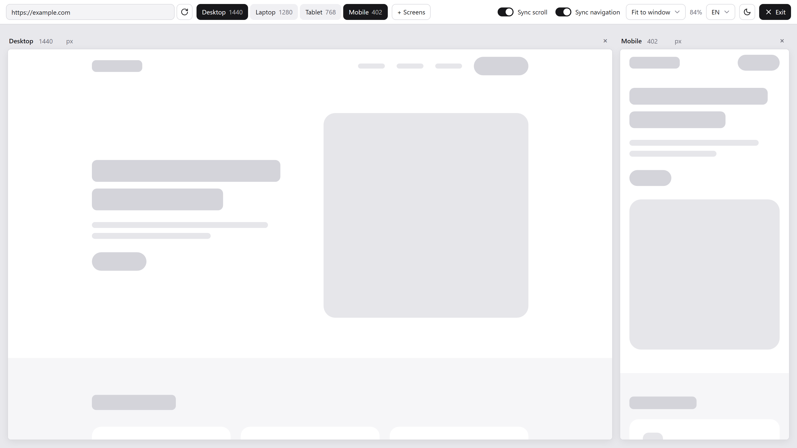
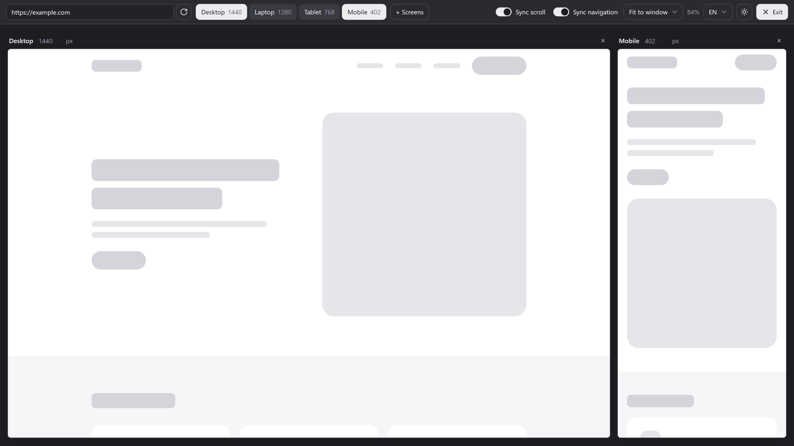
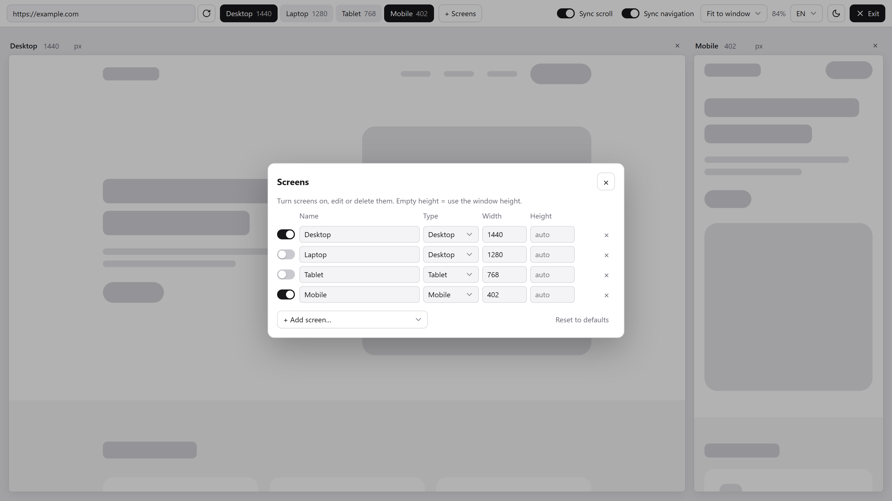

# Viewport Sync

Chrome extension to preview any website at multiple screen sizes side by side (desktop, tablet, mobile), with synced scrolling and navigation.

<table>
  <tr>
    <td></td>
    <td></td>
  </tr>
  <tr>
    <td align="center">Dark theme</td>
    <td align="center">Add, edit and resize screens</td>
  </tr>
</table>

Screenshots use a placeholder demo page.

## Features

- **Side-by-side screens** — Desktop (1440) and Mobile (402) by default, plus Laptop and Tablet ready to turn on.
- **Custom screens** — add presets (iPhone 17, iPhone Air, Galaxy S25, Pixel 10, iPad, MacBook, Full HD…) or your own; rename, change type, width and height, reset or delete.
- **Resize with the mouse** — drag the right edge (width), bottom edge (height) or corner (both). Double-click the bottom edge to go back to auto height.
- **Synced scrolling** — scroll one screen and the others follow to the same section, even when desktop and mobile layouts have different heights.
- **Synced navigation** — click a link in one screen and the others open the same page.
- **Real mobile/tablet behaviour** — in Tablet and Mobile screens the site's JavaScript sees an iPhone/iPad user agent and touch support.
- **Your cookies and logins** — the viewer opens on top of the site's own page, so cookies and sessions are the site's normal ones. Accept the cookie banner once and it's remembered; the other screens reload automatically.
- **Stays on while you browse** — type a new address in Chrome's address bar or refresh, and the viewer opens again in that tab (the icon shows **ON**).
- **Zoom** — fit everything to the window, or pick a fixed percentage.
- **Light and dark theme.**
- **English, Portuguese and French** — English by default; switch language from the menu in the toolbar.

## Install

The extension isn't on the Chrome Web Store yet. To install it from this repository:

1. Download this repository (**Code → Download ZIP**) and unzip it.
2. Open `chrome://extensions` in Chrome.
3. Turn on **Developer mode** (top right).
4. Click **Load unpacked** and choose the unzipped folder.
5. Pin the extension: click the puzzle icon in the toolbar, then the pin next to **Viewport Sync**.

## Use

- On any website, click the Viewport Sync icon. The site opens in all screens.
- To go back to normal, click **Exit** in the top right, or click the icon again. You return to the page you were on.
- Settings (screens, sync options, zoom, theme, language) are saved in Chrome.

## Limitations

- If you navigate inside the screens to a **different** website (another domain), cookies and logins for that site may not work. Open that site in its own tab and click the icon there.
- The server always receives a desktop user agent; only the site's JavaScript sees iPhone/iPad. Sites that serve a separate mobile site from the server (e.g. `m.example.com`) may show the narrow desktop version.
- Sites that scroll inside a container (instead of the whole page) don't sync scrolling.
- On `chrome://` pages and the Chrome Web Store, extensions can't run on the page, so the viewer opens on its own page without cookie sharing.

## How it works

- `overlay.js` / `overlay.css` — the viewer UI, injected on top of the current page inside a shadow root (isolated from the site's styles).
- `frame-sync.js` — runs inside each screen; reports and applies scroll position (matched by page section), link clicks and cookie-consent changes.
- `frame-ua.js` — makes Tablet/Mobile screens report an iPad/iPhone user agent and touch support to the site's JavaScript.
- `background.js` — toggles the viewer from the toolbar icon, keeps it on across page loads, and (only for that tab, only while the viewer is on) removes the headers that stop sites from being shown in frames.

## License

[MIT](LICENSE)
